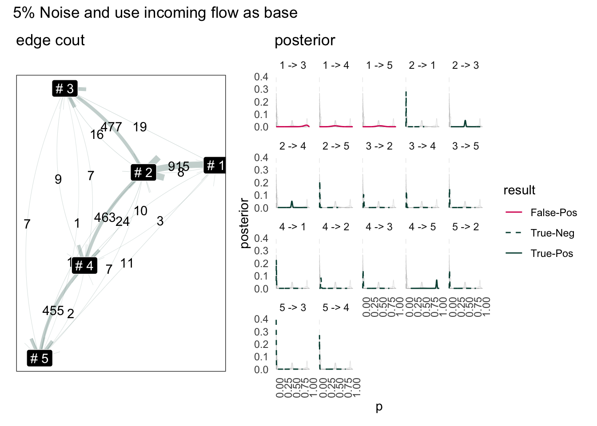

```{r}
#| echo: false

```
*Recreate natural status process flow from a set of random generated event logs.*


```{r, include = FALSE}
knitr::opts_chunk$set(
  collapse = TRUE,
  comment = "#>"
)
```

```{r setup}
#| message: false
#| echo: false
#| code-fold: true
library(sandystatus)
library(tidyverse)
library(patchwork)
theme_set(theme_bw())

## Statistics Experiment =================================
## Study characteristic of sampled random frequency
plot_against_nrml = function(x) {
  n = length(x)
  norm_x = rnorm(n, mean(x), sd(x))
  ggplot() + 
    geom_density(data = data.frame(x),aes(x=x), color="blue",linewidth=1) + 
    geom_density(data = data.frame(norm_x), aes(x = norm_x), color="black",linetype = "dashed") + 
    theme(
      title = ggtext::element_markdown()
    ) + 
    ggtitle("<b>normal</b> against <b style='color:blue'>x</b>") 
}
```


## Introduction

A "status audit log" is a set of data that record status change. A "status" is 
typically categorical variables. Some data warehousing book will can it a "audit log" 
or "snap-shot table".

These data captures business related process, such as
purchase order going through different stage of purchase - from order to shipment; 
or a customer moving through different online booking stage - from *viewing the web-page advert* to *actual purchase*.

Data analyst may seek to answer questions such as 
*how quick it is for an order to move through* 
or *What's the common customer purchase story*. 


This short experiment use a scholastically generated "status change log" and baysian
inference to try answer those questions:

- Can we recreate a status flow graph using those data;
- Predict when and how many certain status will move through; 
- Predict when a status is not moving

## Experiment: Complete Chaotic

### Fake Data

Below is one of many format of record status change:

```{r}
make_fakelog(2)
```

- This example data has only two object (id 1, id2)
- Statues:
  - We are going to pretent status are represented by these numbers 1, 2, 3, 4..
  - Column *from* represent status before change
  - Column *to* represent status after change
- Column *log-time* is when the change has taken place, 
- Column *weight* can represent a numerical value of object (in the purchase order 
context, "weight" can represent price of order).


This table is randomly generated, every status is random sampled and 

Below of extract from how a fake log is made: The time is randomly sampled.
Each status is random sampled.

```r
make_fakelog_1 = function(fake_id, freq, n_status = 3) {
  
  fake_to = sample(seq(n_status), size=freq, replace=T)
  fake_from=lag(fake_to)
  wts = rnorm(freq, 10, 2) # average value is always 10 or 2 so

  x = sample(seq(freq), size=1)
  # Generate Time-stamp For One Single Year
  Year_23 = seq(ymd('2023-01-01'), ymd('2023-12-31'), by='1 day')

  fake_timelog=sort(sample(Year_23, size=freq))
  data.frame(
    id = fake_id,
    from = fake_from,
    to = fake_to,
    logtime=fake_timelog,
    weight = round(wts,2)
  )
}
```


### Statistical characteristics of random sampled time-gaps

A randomly sampled value, comparing with previous value is normally distributed in R. 
(compare against a sample of normal distribution with same mean and standard deviation)
```{r}
n = 1e4
x = runif(n)
diff_x = (x - lag(x))[-1]
norm_x = rnorm(n, mean(diff_x), sd(diff_x))
plot_against_nrml(norm_x) + 
  ggtitle("<b>normal</b> against <b style='color:blue'>x: runif unsorted</b>") 
```
However if the randomly sampled value are ordered the distribution will be more 

```{r}
## (2) Are uniform sample interval exponential or normal? 
## this type with sorting
n = 1e3
x = sort(runif(n))
diff_x = (x - lag(x))[-1]
plot_against_nrml(diff_x) + 
  ggtitle("<b>normal</b> against <b style='color:blue'>x: runif sorted</b>") 
```

If we sample from a set of integer instead the distribution will look similar:
```{r}
## (3) instead of runif just sample from a vector
n = 1e3
x = sort(sample(1:(n*10), n,replace = T))
diff_x = (x - lag(x))[-1]
plot_against_nrml(diff_x) +
  ggtitle("<b>normal</b> against <b style='color:blue'>x: sample from a integer vector</b>")
```

So unsurprisingly the time data follow the same pattern:
```{r}
## this function helps as created a how very
time_delta.log = function(df) {
  df |> 
    group_by(id) |> 
    mutate(last_time = lag(logtime, order_by = logtime)) |> 
    mutate(time_delta = logtime - last_time) |> 
    filter(!is.na(from)) |> 
    ungroup(id)
}
df = make_fakelog(1e3)
change_prequency = df |> 
  time_delta.log()
```

```{r}
change_prequency |> 
  slice_sample(n = 3)
```


```{r}
## now use the similar tool to inspect stochestic status log
change_prequency |> 
  pull(time_delta) |> 
  as.numeric() |> 
  plot_against_nrml() + 
  ggtitle("<b>normal distribution</b> against <b style='color:blue'>sampled time change </b>") +
  xlab("days between status change")
```
This looks acceptable and natural.

It is possible to try approximate distribution of different path
and use distribution to re-sample /predict time_delta

first let's create a graph
Status graph may look like this is simply because the process is stochestic

```{r}
#| code-fold: true
library(ggraph)
change_prequency |> 
  mutate(total_n = n()) |> 
  group_by(from, to) |> 
  summarise(
    median_td = median(time_delta),
    sd = sd(time_delta),
    total_n = first(total_n),
    n = n(),
    .groups = "drop"
  ) |>
  tidygraph::as_tbl_graph() |> 
  mutate(name = paste("#", row_number())) |> 
  ggraph(layout = "kk") +
  geom_edge_bend(
    aes(label = n)
  , arrow = arrow(type="open")
  , alpha = 0.25
  , color = "#004D40"
  , width = 2
  ) +
  geom_node_label(aes(label = name), color = "white", fill = "black") +
  ggtitle(
    "A Chaotic Status Flow Chart",
    stringr::str_replace_all(stringr::str_wrap(width= 50, glue::glue(
        "Each <i>node</i> is a status, each time something pass by it forms an <i>edge</i>. "
      , "When sampled from a random process, the status form a <i>complete graph</i>"))
      , "\n", "<br>"
  )) +
  coord_equal() + 
  theme(title = ggtext::element_markdown())
```

In this flow chart status goes to each status evenly, this is because we sampled
status randomly. Each status has equal change of been sampled together.

### Time Interval of Status Jump

Going back to the question about when:

```{r}
## Then possible to create distribution for each edge type
change_prequency |> 
  mutate(label = paste(from ,"->",to)) |> 
  mutate(time_delta = as.numeric(time_delta, "days")) |> 
  ggplot() + 
  facet_wrap(~label) + 
  geom_histogram(aes(x = time_delta), binwidth = 10) + 
  ggtitle("Distribution of Event Time for Each Edge")
```


```{r}
#| code-fold: true
#| code-summary: function to compute baysian probability
## The most random state is stochastic and full graph
summary.log = function(change_prequency) {
  change_prequency |>
    ungroup() |> 
    mutate(total_n = n()) |> 
    group_by(from) |> mutate(from_n = n()) |> ungroup() |> 
    group_by(from, to) |> 
    summarise(
      median_td = median(time_delta),
      sd = sd(time_delta),
      total_n = first(total_n),
      from_n = first(from_n),
      n = n(),
      .groups = "drop"
    )
}
## use grid method to study posterior distribution
freq_posterior.log = function(
      change_freq_smry
    , total_n = total_n
    , grid_rs = 500
  ) {
  grid_rs = 500
  # .shrink_ = (grid_rs/nrow(change_freq_smry) * 2)
  p_grid = (1:grid_rs/grid_rs)[1:(grid_rs)]
  freq_pst_grid = change_freq_smry |> 
    select(from,to,{{total_n}}, n) |> 
    cross_join(tibble(p=p_grid)) |> 
    mutate(
      likelyhood = dbinom(n, {{total_n}}, p)
    ) |> 
    group_by(from, to) |> 
    mutate(posterior = likelyhood / sum(likelyhood))
  return(freq_pst_grid)
}
## for be able to say the probability of something lower the 0.005 is this:
validate.posterior = function(posterior, valid_edge,ignorable = 0.05) {
  ## second you need an acceptance score
  ## first way to use is acceptance against ignore
  posterior |> 
    group_by(from,to) |>
    filter(p > ignorable) |> 
    summarise(ignorability = sum(posterior)) |> 
    left_join(valid_edge, c("from","to")) |> 
    mutate(valid = coalesce(valid, FALSE)) |> 
    mutate(valid = ifelse(valid, 1, 0)) |>
    mutate(predict = round(ignorability)) |> 
    mutate(result = paste(sep = "-"
        , ifelse(valid == predict, "True", "False")
        , ifelse(predict == 1, "Pos", "Neg")
        )
  )
}

attach_score.posterior = function(posterior, valid_edge,ignorable = 0.05) {
  score = posterior |> 
    validate.posterior(valid_edge,ignorable = 0.05)
  posterior |> 
    left_join(score, c("from", "to"))
}
plot.freq_posterior = function(freq_pst_grid, shadow = T,scales="free",...) {
  if(shadow) {
    geom_shadow_ = (list(geom_line(
      data=freq_pst_grid |> mutate(label1 = paste(from,to))
      , aes(x = p, y= posterior, group = label1),color="grey",alpha=0.4,linewidth=0.2
    )))
  } else {
    geom_shadow_ = list(NULL)
  }
  freq_pst_grid |> 
    mutate(label = paste(from , "->", to)) |> 
    filter(posterior != 0) |> 
    filter(!is.na(posterior)) |> 
    ggplot(aes(x = p, y= posterior,...)) + 
    geom_shadow_ +
    geom_line() +
    facet_wrap(~label,scales=scales)
}

```
  
### Posterior probability

The way we sample posterior probability is simply by compute binomial 
probability across a grid or probability. This is know as  
"beta-binomial". 


```{r}
#| warning: false
change_freq_smry=change_prequency |>
  summary.log()

## use sample method 
freq_pst_grid = change_freq_smry |> 
  freq_posterior.log()

freq_pst_grid |> 
  plot.freq_posterior() + 
  ggtitle("Posterior of complete random graph") + 
  scale_x_continuous(limits = c(0.025, 0.10))
```
It is difficult to tell information from this graph, this is expected.


## Experiment: Pre-Determined Status

Pre-determined means which status can flow to which status follow a set of schema

### Prefectly Pre-Determined Status

Now instead of sample randomly we are going to mandate status which can only 
flow to these statuses:

```.txt
1 ------> 2 -----> 3 
           \
            4
              \
               5
```

To sample a audit log, we are going to sample for all possible shortest path 
between leaf and nodes:

```{r}
#| message: false
library(igraph)

### we can possiblely try one with schema just to see what difference it makes
n_particle = 1000

state_schema = igraph::graph_from_literal(1 -+ 2 -+ 3:4,4-+5)

## either sample terminals or sample intermediate terminals
leaves = V(state_schema)[degree(state_schema, mode="out" ) == 0]
paths = (state_schema |> shortest_paths(1, leaves))$vpath
edge_to = sample(paths,n_particle,replace=T) |> imap_dfr(~tibble(id = .y, to = names(.x)))
edge_list = edge_to |>  group_by(id) |> 
  mutate(.order = row_number(), from = lag(to, order_by =.order)) |> 
  select(id,from,to)

## try assign random years to log
Year_23 = seq(ymd('2023-01-01'), ymd('2023-12-31'), by='1 day')
n_per_obj = pull(count(edge_list, id),n)
logtime = n_per_obj |> map_dfr(~tibble(logtime = sort(sample(Year_23, .x))))
weight = n_per_obj |> map_dfr(~tibble(weight = rnorm(.x, mean = 10, sd = 2) ))
```

```{r}
log = bind_cols(edge_list, logtime, weight)
freq_posterior = log |> 
  time_delta.log() |> 
  summary.log() |> 
  freq_posterior.log()
```

```{r}
log |> 
  time_delta.log() |> 
  summary.log() |> 
  tidygraph::as_tbl_graph() |> 
  mutate(name = paste("#",name)) |> 
  ggraph(layout = "kk") +
  geom_edge_bend(
    aes(label = n)
  , arrow = arrow(type="open")
  , alpha = 0.25
  , color = "#004D40"
  , width = 2
  ) +
  geom_node_label(aes(label = name), color = "white", fill = "black") +
  ggtitle("Sample from a Custom Defined Status Flow Chart") +
  coord_equal()
```


```{r}
freq_posterior |> 
  plot.freq_posterior(shadow = T) +
  ggtitle("Natural Progressing Status Log: Posterial of Edge"
          , stringr::str_replace_all(stringr::str_wrap(
            width = 80
            , string = glue::glue(
                ""
              , "If <b>every object has passed through</b> all the status till the end"
              , ", the joined edges has higher probability to occur than branches."
              , "This is because of the topology of graph: "
              , "the closer the edge path is towards the destiny of graph lower probability"
            )), "\n", "<br>")
  ) + 
  theme(title = ggtext::element_markdown())
```
2 -> 3 and 2 -> 4 has the same probability occurrence this is because they are 
not the same as the very so you will need depend prior probability to depend on previous status

```{r}
log |> 
  time_delta.log() |> 
  summary.log() |> 
  freq_posterior.log(from_n) |> 
  plot.freq_posterior(T) +
  ggtitle("Natural Progressing Status Log: Posterior of Possible Status"
          , stringr::str_replace_all(stringr::str_wrap(
            width = 80
            , string = glue::glue(
              ""
              , "If <b>every object has passed through</b> all the status till the end,"
              , "where there are branches, the status the will split; but "
              , " anytime there are only one path forward the certaintiny increase"
            )), "\n", "<br>")
  ) + 
  theme(title = ggtext::element_markdown())
```

Is this good enough for us to tell which path is true path? 
Possibly yes. If a particular status path path rarely occur, they would goes near the 0 probability.
Anywhere if there are certainty towards our model
we expect probability density to be much thinner and more local;

Does this model able to tell which path is real in a sensible way?
Yes we are comparing this process of each object moving through each status as 
a random process of flipping a coin If the heads up, then move from 2 to 3, 
if tills up, move from 2 -> 4. 
Eventually we get a posterior tell us, 50% of the time it move 2->3 and 50%
of the time 2->4.

It's easy to observe status 3, and 4 has is much shorter in comparative to 1, 5.
This is because 3 and 4 share the base of any 2 status. Perhaps it sensible to take
them into consideration. In graph terminology this is the *degree of node* (in 
this case degree of node 2 `degree(V(g)[2])`). 

So what if the status does not move at all? Where status could stagnate or could other wise 
not able to progress forward.


### Introduce Noise to Status Flow

Introduce noise by replace 5% of legit status to random sample. Using the same 
log data from above.

```{r}
#| code-fold: true
#| code-summary: introduce noise
## how can we wrack a data? 
## by insert random status **in between** the line
## wrack 2% of data by 
possible_status = names(V(state_schema))

## index each row
log_ided = log |> 
  ungroup() |> 
  mutate(row_id = row_number()) |> 
  relocate(row_id)

## random slice 0.05 of the row 
rows_to_change=log_ided |> 
  slice_sample(prop = 0.05) |> 
  select(row_id, to)

## replace the to value to random sampled value
new_to_s = sample(possible_status, nrow(rows_to_change),replace=T)
new_rows = rows_to_change |> 
  mutate(to = new_to_s, .disrupted = T)

## correct the from to something else
noisy_log = log_ided |> 
  mutate(.disrupted = F) |> 
  rows_update(new_rows) |> 
  group_by(id) |> 
  mutate(from = lag(to, order_by = logtime)) |> 
  ungroup() |> 
  select(-row_id)
```

```{r}
#| code-fold: true
#| code-summary: example of a disrupted status
ect_noisy_log = noisy_log |> 
  filter(.disrupted) |> 
  slice_sample(n=1)
noisy_log |> semi_join(ect_noisy_log,"id")
```

In this example object `r ect_noisy_log$id` change from `r ect_noisy_log$from` 
to `r ect_noisy_log$to` at `r as.character(ect_noisy_log$logtime)`. This is purposefully made to violate the schema design set out before.

#### KK Layout for Stablisation

Now the graph may connect to a full graph. But since the percentage is small, 
it is possible to use [*Kamada-Kawai layout*](https://ggraph.data-imaginist.com/reference/layout_tbl_graph_stress.html)
algorithm to layout based on *inverse-frequency* of edge occurrence.


Although the graph itself is a near *complete graph*, when visualizing the 
graph stablise to one that looks like original graph. 

#### Scoring from Baysian Model

The socring here is very simple. Use 5% as threshold. If there is a "good chance" that 
the intrinsic probability of edge is less than 5%, this edge is ignorable. 
Otherwise keep it. The "good chance" means sum posterior below "5 %" p. Here 
is just a simple rounding up. 

#### Result use sum of outflow as base

```{r}
#| code-fold: true
#| out-width: 100%

stopifnot(exists("state_schema"))

valid_edge = state_schema |> 
  as_edgelist() |> 
  data.frame()
names(valid_edge) <- c("from","to")
valid_edge["valid"] <- TRUE

noisy_log.smry = noisy_log |> 
  time_delta.log() |> 
  summary.log()
## posteror probability
noisy_log.posterior = noisy_log.smry |> 
  freq_posterior.log(total_n = from_n) |> 
  attach_score.posterior(valid_edge)

Posterior_Score_Scale = function() {
  return(list(
    scale_color_manual(
    values=c("True-Pos"="#004D40","True-Neg"="#004D40",
             "False-Pos"="#D81B60","False-Neg"="#D81B60")
  ),
  scale_linetype_manual(
    values = c("True-Pos"="solid","True-Neg"="dashed",
             "False-Pos"="solid","False-Neg"="dashed")
  ))
  )
}

## graph of path
data_as_graph = noisy_log.smry |> 
   tidygraph::as_tbl_graph()

g1 = noisy_log.posterior |> 
  filter(from != to) |> 
  plot.freq_posterior(
    color = result,
    linetype=result,
    scales="fixed") + 
  Posterior_Score_Scale() +
  theme_minimal() +
  theme(
      axis.text.x = element_text(angle=90)
    , panel.grid.major.y = element_blank()
    , panel.grid.minor.y = element_blank()
    , panel.grid.major.x = element_blank()
    , panel.grid.minor.x = element_blank()
    # , legend.position = "top"
  ) +
  ggtitle("posterior") 

set.seed(101)

g2 = data_as_graph |> 
  mutate(name = paste("#",name)) |> 
  ggraph(layout ="kk", weights = 1/n) +
  geom_edge_fan(
    aes(label = n, width = n)
  , arrow = arrow(type="open")
  , alpha = 0.25
  , position = "jitter"
  , color = "#004D40"
  , n = 100
  ) +
  geom_node_label(aes(label = name), color = "white", fill = "black") +
  # ggtitle("Sample from a Custom Defined Status Flow Chart") +
  # coord_equal() +
  scale_edge_width(range = c(0.1,2.5)) +
  theme(legend.position = "none") + 
  ggtitle("edge count")

(g2 | g1) + 
  plot_layout(ncol = 2, guides ="collect") +
  plot_annotation(title = "After introducing 5% of noise") + 
  theme(
    legend.position = "top",legend.direction = 'vertical'
    )
```


My favorite quote from the book "rethink statistics":
> *Once your model produces a posterior distribution, the models work is done. But your work has just begun*

The model can helping us of cutting off noisy edges but we need something similar
to a confidence interval.

1 -> 3, 1 -> 4 would be highly unlikely. The tricky part is 5 -> 2 or 3 -> 5. 
These two path are clearly invalid, but the Bayesian has output it to be
lower certaintly path.
Seems the model is bad **where there is a terminal node**. This is because 
from 5, it can still go to 1 or 3. So perhaps, instead of simply sum total out flow source, we need **count how many flow enter the node**.


#### Result use sum of inflow as base:

```{r}
#| code-fold: true
#| out-width: 100%
summary.log = function(change_prequency) {
  income_n.df = change_prequency |> 
    ungroup() |> 
    group_by(to) |> 
    summarise(income_n = n()) |> 
    rename(from = to)
  change_prequency |>
      ungroup() |> 
      mutate(total_n = n()) |> 
      group_by(from) |> mutate(from_n = n()) |> ungroup() |> 
      group_by(to) |> mutate(to_n = n()) |> ungroup() |> 
      group_by(from, to) |> 
      summarise(
        median_td = median(time_delta),
        sd = sd(time_delta),
        total_n = first(total_n),
        from_n = first(from_n),
        to_n = first(to_n),
        n = n(),
        .groups = "drop"
      ) |> 
    left_join(income_n.df, by = "from")
}

noisy_log.smry = noisy_log |> 
  time_delta.log() |> 
  summary.log()
noisy_log.posterior = noisy_log.smry |> 
  freq_posterior.log(total_n = income_n) |> 
  attach_score.posterior(valid_edge)

g3 = noisy_log.posterior |> 
  filter(from != to) |> 
  plot.freq_posterior(
    color = result,
    linetype=result,
    scales="fixed") + 
  Posterior_Score_Scale() + 
  theme_minimal() +
  theme(
      axis.text.x = element_text(angle=90)
    , panel.grid.major.y = element_blank()
    , panel.grid.minor.y = element_blank()
    , panel.grid.major.x = element_blank()
    , panel.grid.minor.x = element_blank()
  ) + 
  ggtitle("posterior")

set.seed(101)
g4 = noisy_log.smry |> 
  tidygraph::as_tbl_graph() |> 
  mutate(name = paste("#",name)) |> 
  ggraph(layout ="kk", weights = 1/n) +
  geom_edge_fan(
    aes(label = n, width = n)
  , arrow = arrow(type="open")
  , alpha = 0.25
  , position = "jitter"
  , color = "#004D40"
  , n = 100
  ) +
  geom_node_label(aes(label = name), color = "white", fill = "black") +
  # ggtitle("Sample from a Custom Defined Status Flow Chart") +
  # coord_equal() +
  ggtitle("edge cout") +
  scale_edge_width(range = c(0.1,2.5)) +
  theme(legend.position = "none")

(g4 | g3) + 
  plot_layout(ncol = 2) +
  plot_annotation(title = "5% Noise and use incoming flow as base")
```


Although the result to terminal node has improved, the result for source node has worse off (1->4, 1->5).
This is because the amout of flow back to 1 is already scares (only `r noisy_log.smry |> filter(to == 1) |> slice(1) |> pull(income_n)` total edge). 

Overall, by using sum of incoming edge, the number of false-positive edges reduced but this is rather artificial. The status flow schema we defined here has only one source node.

"1->2" has disappeared from posterior because the number of edge pointing to "#1" is lower than the amout going out. So "#1" going out to "#2" is 
simply impossible. Knowing this we can probability fix this simply add difference
out out-flow from 1.

[tbc]

## Reference/Reading List

- [McElreath, R. (2018). Statistical rethinking: A Bayesian course with examples in R and Stan. Chapman and Hall/CRC.](https://www.taylorfrancis.com/books/mono/10.1201/9781315372495/statistical-rethinking-richard-mcelreath): Thank this book for everything I understand
about Baysian inference.

- [Thomas Lin Pedersen (2023)](https://www.data-imaginist.com/posts/2017-02-06-ggraph-introduction-layouts/)'s Package {{ggraph}} is amazing, but I add this link for use {{tweenr}} in the future.

- [{{bupar}} Package for business process mining](https://bupar.net/) of course every time you have a new idea, chances are someone else has already invented (and commercialized) them.

- [Research by Dr.Mieke Jans ](https://www.maastrichtuniversity.nl/mj-jans/research): Dr Mieke Jans is a contributor of {{bupar}}. Her papers maybe of interests.


